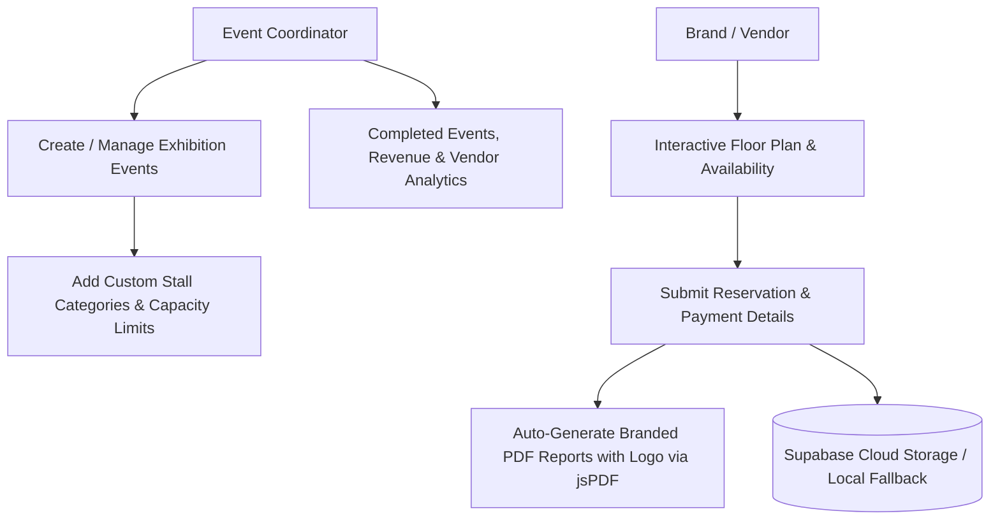

# sliceEVENT — Exhibition & Stall Management Platform 🎪✨

<div align="center">

[](https://react.dev)
[](https://www.typescriptlang.org/)
[](https://supabase.com/)
[](https://tailwindcss.com/)
[](https://github.com/parallax/jsPDF)
[](https://motion.dev/)

**Comprehensive Stall Reservation, Vendor Onboarding & Exhibition Management Platform by A Generative Slice.**

</div>

---

## 📖 Overview

**sliceEVENT** is an all-in-one digital command center built specifically for lifestyle exhibitions, pop-ups, flea markets, and trade shows. Engineered by **A Generative Slice**, this platform digitizes the entire exhibition operations pipeline.

Event organizers can schedule city exhibitions, define dynamic stall categories with custom capacities, process vendor registrations, issue instant branded PDF invoices & availability reports, broadcast real-time availability on WhatsApp, and synchronize reservations with cloud **Supabase** databases or local device storage.

---

## 🌟 Key Functional Pillars



### 1. 🎪 Dynamic Stall Category System
- No locked or rigid templates: organizers can add as many stall categories as needed (e.g. *Front Pavilion, Food Village, Designer Row, VIP Lounge*) and assign exact custom capacities.
- Full backward-compatibility with existing exhibitions and legacy stall configurations.

### 2. 📄 Dual Branded PDF Generation
- **Vendor Copy:** Features the **A Generative Slice** brand crest, overall occupancy metrics, dedicated per-category breakdown (Total, Booked, and Available counts per zone), and layout blueprint—with **zero confidential financial data**.
- **Owner Executive Copy:** Complete financial audit with revenue totals, advance collected, pending balance, and detailed vendor ledger.

### 3. 📲 1-Click WhatsApp Availability Broadcaster
- Auto-generates clean, structured vacancy updates listing exact vacant and booked stalls, ready to copy and paste directly into WhatsApp vendor groups.

### 4. 🗺️ Interactive Blueprint & Floor Plan
- Upload venue layout maps with interactive 1-finger pan and 2-finger pinch-to-zoom on mobile and desktop.

### 5. 🔄 Hybrid Local-First & Cloud Architecture
- Operates 100% offline with zero data loss using local device storage.
- Optional 1-click **Supabase** cloud sync for real-time multi-device collaboration.
- 1-click JSON backup export and restore.

---

## 🛠️ Technology Stack

| Layer | Technology |
|---|---|
| **Frontend Framework** | React 19 with Fast Refresh |
| **Language** | TypeScript strict typing |
| **Styling** | Tailwind CSS v4 with brand warm-orange palette |
| **Animations** | Motion (Framer Motion v12) |
| **Database** | Supabase (`@supabase/supabase-js`) with local fallback |
| **PDF Generation** | jsPDF (with high-res vector branding) |
| **Icons** | Lucide React |
| **Bundler** | Vite 6 |

---

## 📂 Repository Structure

```
sliceEVENT/
├── public/                     # Static media and brand graphics (agenerativeslicelogo.jpg)
├── src/
│   ├── components/             # Screen views & UI elements
│   │   ├── Navigation.tsx      # Top desktop navbar & mobile bottom bar
│   │   ├── HomeView.tsx        # Active exhibitions dashboard
│   │   ├── CreateEventView.tsx # Exhibition creation wizard with dynamic categories
│   │   ├── SeriesStallsView.tsx # Stall booking grid and payment logger
│   │   ├── EventDetailsView.tsx # Specific event analytics & roster
│   │   ├── CompletedEventsView.tsx # Archived exhibitions
│   │   ├── SupportView.tsx     # Direct developer & concierge support
│   │   └── SupabaseModal.tsx   # Cloud sync & backup modal
│   ├── lib/
│   │   ├── storage.ts          # Local storage, stats calculation & Supabase client
│   │   └── pdfGenerator.ts     # Branded PDF generators (Vendor & Owner copies)
│   ├── types.ts                # Event, Stall, and Vendor type definitions
│   ├── App.tsx                 # Core application state orchestrator
│   └── main.tsx                # Application mount point
├── package.json                # Dependencies and npm scripts
├── vite.config.ts              # Vite bundler configuration
└── .env.example                # Environment variable template
```

---

## 🚀 Getting Started

### Prerequisites
- Node.js v18 or later
- npm v9 or later

### Installation & Development

```bash
# 1. Clone repository
git clone https://github.com/A-Generative-Slice/sliceEVENT.git
cd sliceEVENT

# 2. Install dependencies
npm install

# 3. Start development server
npm run dev
```

Visit `http://localhost:3000` to interact with the platform.

---

## ⚙️ Environment Variables (Optional Supabase Sync)

Create a `.env` file to sync bookings to a remote Supabase instance:

```env
VITE_SUPABASE_URL=https://your-project.supabase.co
VITE_SUPABASE_ANON_KEY=your_supabase_anon_key
```

*(Note: If Supabase credentials are not provided, the platform gracefully operates in local storage mode.)*

---

## 📄 License & Attribution

Designed and engineered by **A Generative Slice**.  
Copyright © 2026 A Generative Slice. All rights reserved.
